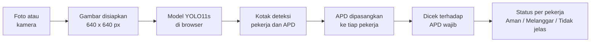

# SafetyCam

**Deteksi APD pekerja konstruksi dari foto atau kamera, langsung di browser.**

SafetyCam memakai AI untuk mengenali helm, rompi, sarung tangan, sepatu safety, dan kacamata pada pekerja, lalu menandai setiap pekerja sebagai **Aman**, **Melanggar**, atau **Tidak jelas**. Semua proses terjadi di perangkat pengguna. Foto dan video tidak dikirim ke server.

Riset oleh **IRIS** (Innovative Research on Intelligent System), Fakultas Teknologi Maju dan Multidisiplin, Universitas Airlangga.

---

## Daftar isi

1. [Ringkasan untuk penjaga booth](#1-ringkasan-untuk-penjaga-booth)
2. [Masalah yang diselesaikan](#2-masalah-yang-diselesaikan)
3. [Cara kerja dalam satu gambar](#3-cara-kerja-dalam-satu-gambar)
4. [Dataset](#4-dataset)
5. [Model AI](#5-model-ai)
6. [Akurasi dan cara menjelaskannya](#6-akurasi-dan-cara-menjelaskannya)
7. [Aturan penilaian per pekerja](#7-aturan-penilaian-per-pekerja)
8. [Stack website](#8-stack-website)
9. [Alur website](#9-alur-website)
10. [Panduan booth](#10-panduan-booth)
11. [Keterbatasan](#11-keterbatasan)
12. [Untuk developer](#12-untuk-developer)
13. [Lisensi dan kredit](#13-lisensi-dan-kredit)

---

## 1. Ringkasan untuk penjaga booth

Kalau hanya sempat membaca satu bagian, baca ini.

> Di proyek konstruksi, APD hanya melindungi kalau benar-benar dipakai, dan pengawas tidak bisa memeriksa semua pekerja setiap saat. SafetyCam membantu memeriksanya. Cukup unggah foto atau arahkan kamera, lalu AI mengenali helm, rompi, dan APD lain, dan memberi status untuk setiap pekerja: aman, melanggar, atau tidak jelas. Semuanya berjalan di browser, jadi fotonya tidak dikirim ke mana pun, dan setelah dibuka sekali website ini tetap bisa dipakai tanpa internet.

Lima hal yang paling sering perlu dijelaskan:

| Pertanyaan | Jawaban singkat |
|---|---|
| Ini apa? | Website AI untuk mengecek pemakaian APD pekerja konstruksi. |
| AI-nya apa? | YOLO11s, model pengenal objek, dilatih dengan 1.416 foto lokasi kerja. |
| Seakurat apa? | Pada data uji, sekitar 9 dari 10 helm dan rompi berhasil dikenali. Tetap alat bantu, bukan pengganti pengawas. |
| Fotonya ke mana? | Tidak ke mana-mana. Diproses di perangkat itu sendiri. |
| Bisa dipakai di HP? | Bisa, lewat browser. Kecepatannya tergantung HP-nya. |

---

## 2. Masalah yang diselesaikan

- Kecelakaan kerja sering terjadi karena APD tidak dipakai, padahal APD-nya tersedia.
- Pengawas K3 harus memeriksa banyak pekerja di area yang luas, sehingga satu pekerja tanpa helm mudah terlewat.
- SafetyCam mempercepat pemeriksaan: pekerja yang perlu diingatkan langsung ditandai, dengan alasannya.

SafetyCam **membantu** pemeriksaan. Keputusan tetap di tangan pengawas.

---

## 3. Cara kerja dalam satu gambar



Dalam bahasa sehari-hari:

1. **Melihat gambar.** Model AI mencari pekerja dan APD di dalam foto, lalu menggambar kotak di sekelilingnya.
2. **Mencocokkan.** Setiap helm, rompi, dan APD lain dipasangkan ke pekerja yang memakainya.
3. **Mengecek aturan.** APD yang terlihat dibandingkan dengan daftar APD wajib (bawaannya helm dan rompi).
4. **Memberi status.** Setiap pekerja ditandai hijau (aman), merah (melanggar), atau oranye (tidak jelas).

---

## 4. Dataset

| | |
|---|---|
| Nama | [Construction-PPE](https://docs.ultralytics.com/datasets/detect/construction-ppe/) dari Ultralytics |
| Jumlah foto | 1.416 foto lokasi kerja, masing-masing diberi kotak label |
| Pembagian | 1.132 latih, 143 validasi, 141 uji. Tidak ada foto yang sama di dua bagian. |
| Lisensi | AGPL-3.0 |

### 11 kelas

| Kelas di dataset | Arti | Jenis |
|---|---|---|
| `helmet` | Helm | APD dipakai |
| `vest` | Rompi | APD dipakai |
| `gloves` | Sarung tangan | APD dipakai |
| `boots` | Sepatu safety | APD dipakai |
| `goggles` | Kacamata | APD dipakai |
| `no_helmet` | Tanpa helm | Pelanggaran |
| `no_gloves` | Tanpa sarung tangan | Pelanggaran |
| `no_boots` | Tanpa sepatu safety | Pelanggaran |
| `no_goggle` | Tanpa kacamata | Pelanggaran |
| `none` | Tanpa rompi | Pelanggaran |
| `Person` | Pekerja | Orang |

Catatan:
- Dataset tidak punya kelas `no_vest`. Kotak `none` selalu berada di badan, jadi diperlakukan sebagai "tanpa rompi".
- Contoh pelanggaran jauh lebih sedikit daripada contoh APD yang dipakai. Supaya model cukup sering melihatnya, foto yang memuat kelas langka diulang saat training (*repeat factor sampling*). Data latih jadi 1.260 entri dari 1.132 foto.

---

## 5. Model AI

| | |
|---|---|
| Arsitektur | **YOLO11s** dari Ultralytics, model deteksi objek |
| Ukuran | 9,4 juta parameter, input 640 x 640 px |
| Training | Maksimal 200 epoch, berhenti otomatis bila 50 epoch tidak membaik |
| Perangkat training | NVIDIA GeForce RTX 5090 (32 GB), Ultralytics 8.4, PyTorch 2.11 |
| Format di website | ONNX dengan bobot float16, 19 MB |

**Kenapa YOLO11s?** Sebelum training final, beberapa model dibandingkan: YOLO11n, YOLO11s, dan YOLO11m, pada ukuran input 640 dan 960. YOLO11s 640 paling baik menangkap pelanggaran di antara model yang masih cukup ringan untuk berjalan di browser. Seluruh eksperimen ada di [`training/ppe_modeling.ipynb`](training/ppe_modeling.ipynb).

**Threshold per kelas.** Setiap kelas punya batas keyakinan sendiri (`web/model/thresholds.json`), yang disetel di data validasi. Kelas pelanggaran disetel supaya lebih banyak tertangkap, kelas lain supaya seimbang.

**Kompresi.** Model diubah dari float32 (37,9 MB) ke float16 (19,0 MB). Hasil deteksi pada 7 foto contoh tetap sama: 80 dari 80 kotak cocok.

---

## 6. Akurasi dan cara menjelaskannya

Diukur pada **141 foto uji** yang tidak dipakai saat training.

| Kelas | Recall (berapa yang ketemu) | mAP50 |
|---|---|---|
| Helm | 90% | 92% |
| Rompi | 88% | 90% |
| Pekerja | 80% | 86% |
| Kacamata | 74% | 78% |
| Sarung tangan | 73% | 77% |
| Sepatu safety | 64% | 74% |
| Tanpa rompi (`none`) | 40% | 35% |
| Tanpa helm | 15% | 20% |
| Tanpa kacamata | 10% | 11% |
| Tanpa sarung tangan | 7% | 9% |
| Tanpa sepatu safety | 0% | 1% |

**Kalimat yang aman dipakai di booth:** "Pada data uji, sekitar 9 dari 10 helm dan rompi berhasil dikenali."

**Kalau ditanya kenapa angka keseluruhan (mAP50) hanya 52%:** angka itu rata-rata dari 11 kelas, dan kelas "tanpa APD" sangat jarang di dataset sehingga nilainya rendah. Karena itu SafetyCam tidak bergantung pada kelas "tanpa APD" untuk helm dan rompi. Yang dipakai adalah cara berikut.

**Penilaian per pekerja.** Untuk APD wajib, SafetyCam memeriksa apakah helm atau rompi **terlihat** pada pekerja itu (lihat [bagian 7](#7-aturan-penilaian-per-pekerja)). Pada data uji, cara ini menandai 30 dari 38 pekerja yang benar-benar tanpa helm (79%), dibanding 23 dari 38 (61%) bila hanya mengandalkan kelas "tanpa helm". Dari semua pekerja yang ditandai tanpa helm, 70% memang tanpa helm.

**Jangan katakan:** "akurat 100%", "menjamin keselamatan", atau "menggantikan pengawas".

---

## 7. Aturan penilaian per pekerja

Logika ini ada di [`web/js/compliance.js`](web/js/compliance.js), dengan versi Python di [`training/compliance.py`](training/compliance.py).

1. **Memasangkan APD ke pekerja.** Sebuah kotak APD dianggap milik seorang pekerja kalau minimal 50% luasnya berada di dalam kotak pekerja itu. Kotak pekerja diperluas 10% supaya helm yang menonjol di atas kepala tetap terhitung.
2. **APD wajib (bawaan: helm dan rompi)** memakai aturan "absen": kalau pekerjanya cukup besar di foto dan APD itu tidak terlihat padanya, ia dianggap melanggar. "Cukup besar" berarti tinggi pekerja minimal 30% tinggi gambar untuk helm, dan berapa pun untuk rompi.
3. **APD yang tidak wajib** hanya ditandai kalau model melihatnya secara langsung tidak dipakai (misalnya kotak "tanpa sarung tangan").
4. **Status pekerja:**
   - **Aman:** semua APD wajib terlihat.
   - **Melanggar:** ada APD wajib yang tidak terpakai.
   - **Tidak jelas:** APD wajib belum bisa dipastikan, misalnya karena pekerja terlalu kecil atau terpotong.

Daftar APD wajib bisa diubah di panel hasil. Kacamata tidak memakai aturan "absen" karena hasilnya di data uji kurang baik, jadi kacamata wajib yang tidak terlihat menghasilkan status "Tidak jelas", bukan "Melanggar".

---

## 8. Stack website

Website ini statis: HTML, CSS, dan JavaScript biasa, **tanpa framework dan tanpa build step**. Tidak ada server backend.

| Bagian | Teknologi |
|---|---|
| Tampilan | HTML, CSS, JavaScript (ES modules) |
| Menjalankan model | [onnxruntime-web](https://onnxruntime.ai/) 1.20.1, memakai **WebGPU** bila ada dan **WebAssembly** bila tidak |
| Pasca-proses | Penyaringan kotak (NMS) dan aturan per pekerja ditulis di JavaScript |
| Offline | Service worker (PWA) menyimpan halaman, model, dan runtime di cache browser |
| Penyimpanan | IndexedDB untuk riwayat pelanggaran, localStorage untuk pengaturan APD wajib |
| Peringatan | Web Audio untuk bunyi, Vibration API untuk getar di HP |
| Font | Barlow dan Barlow Condensed, disimpan lokal |
| Test | `node:test` (29 test) |
| Deploy | Hosting statis, misalnya Vercel |

### Peta file

| File | Isi |
|---|---|
| [`web/index.html`](web/index.html) | Halaman |
| [`web/js/app.js`](web/js/app.js) | Alur halaman: foto, kamera, panel hasil, riwayat, pengaturan |
| [`web/js/detector.js`](web/js/detector.js) | Memuat model dan menjalankan deteksi |
| [`web/js/postprocess.js`](web/js/postprocess.js) | Mengubah keluaran model menjadi kotak, NMS, threshold |
| [`web/js/compliance.js`](web/js/compliance.js) | Aturan per pekerja dan status |
| [`web/js/tracker.js`](web/js/tracker.js) | Nomor pekerja yang tetap antar-frame kamera, ekspor CSV |
| [`web/js/draw.js`](web/js/draw.js) | Menggambar kotak dan strip status foto hasil |
| [`web/js/store.js`](web/js/store.js) | Riwayat pelanggaran di IndexedDB |
| [`web/sw.js`](web/sw.js) | Service worker untuk mode offline |
| [`web/model/`](web/model/) | Model ONNX, daftar kelas, threshold, aturan per pekerja, metrik |
| [`web/vendor/`](web/vendor/) | onnxruntime-web dan font, disimpan lokal |

---

## 9. Alur website

### Mode Foto

1. Pengunjung membuka website. Model (sekitar 40 MB bersama runtime) diunduh sekali, lalu tersimpan di cache.
2. Pilih atau ubah **APD wajib**. Bawaannya helm dan rompi.
3. Unggah foto (JPG, PNG, WebP), atau pilih salah satu dari tiga foto contoh.
4. Hasil muncul dalam hitungan detik:
   - kotak hijau untuk APD, dan kotak pekerja berwarna sesuai statusnya;
   - panel status: Aman, Pelanggaran, atau Kurang jelas;
   - daftar per pekerja beserta alasannya, misalnya "#2 Melanggar, tanpa helm".
5. Tekan **Unduh foto hasil** untuk menyimpan foto bertanda beserta strip status dan waktu.
6. Slider **Sensitivitas**: geser ke kanan untuk menangkap lebih banyak pelanggaran, ke kiri untuk mengurangi deteksi keliru.

### Mode Kamera

1. Buka tab **Webcam**, lalu tekan **Nyalakan kamera**.
2. Setiap pekerja diberi nomor yang tetap selama ia terlihat di kamera.
3. Status dihaluskan dari beberapa frame terakhir, supaya satu frame yang keliru tidak langsung mengubah status.
4. Setiap pelanggaran baru dicatat sekali di **Riwayat pelanggaran**, lengkap dengan jam dan foto kecil, disertai bunyi dan getar (bisa dimatikan).
5. Riwayat tetap tersimpan setelah halaman di-refresh, dan bisa diunduh sebagai CSV yang bisa dibuka di Excel.
6. Kalau perangkat punya lebih dari satu kamera, kamera bisa dipilih di bar video.

---

## 10. Panduan booth

### Sebelum booth dibuka

- [ ] Jalankan website (lihat [bagian 12](#menjalankan-di-laptop)) dan buka sekali **selagi ada internet atau server lokal menyala**, sampai panel model menampilkan "bisa dipakai offline".
- [ ] Coba ketiga foto contoh. Pastikan contoh "tanpa helm" menghasilkan **Pelanggaran**.
- [ ] Coba mode kamera dan izinkan akses kamera di browser.
- [ ] Hapus riwayat pelanggaran dari hari sebelumnya (tombol **Hapus**).
- [ ] Kembalikan **APD wajib** ke helm dan rompi.
- [ ] Siapkan helm proyek untuk demo kamera, kalau ada.

### Skenario demo sekitar 2 menit

1. **Buka dengan masalahnya.** "Pengawas tidak bisa memeriksa semua pekerja setiap saat. SafetyCam membantu memeriksanya otomatis."
2. **Foto contoh "Pekerja angkut bata tanpa helm".** Tunjukkan bahwa pekerja #2 ditandai merah dengan alasan "tanpa helm", sedangkan pekerja #1 hijau.
3. **Foto contoh "Briefing di gerbang proyek".** Tunjukkan bahwa tujuh pekerja dinilai sekaligus.
4. **Mode kamera.** Minta pengunjung berdiri di depan kamera tanpa helm, lalu memakai helm, dan tunjukkan statusnya berubah serta pelanggaran tercatat di riwayat. Coba skenario ini sendiri sebelum booth dibuka, karena hasil di kamera dipengaruhi cahaya dan jarak.
5. **Tutup dengan privasi.** "Semua ini berjalan di laptop ini. Fotonya tidak dikirim ke mana pun."

### Pertanyaan yang sering muncul

**Apakah foto saya disimpan atau dikirim?**
Tidak dikirim. Semua diproses di perangkat. Yang disimpan hanya riwayat pelanggaran di mode kamera (jam, nomor pekerja, dan foto kecil), di browser perangkat itu sendiri, dan bisa dihapus kapan saja.

**Butuh internet?**
Hanya saat pertama kali dibuka, untuk mengunduh model. Setelah itu website tetap jalan tanpa koneksi.

**AI-nya belajar dari mana?**
Dari 1.416 foto lokasi kerja yang sudah diberi label kotak untuk setiap helm, rompi, dan APD lain (dataset Construction-PPE dari Ultralytics).

**Seberapa akurat?**
Pada data uji, sekitar 9 dari 10 helm dan rompi berhasil dikenali. Sarung tangan dan sepatu safety lebih sering keliru. Karena itu SafetyCam disebut alat bantu.

**Kenapa ada pekerja yang tidak terdeteksi, atau statusnya "Tidak jelas"?**
Biasanya karena pekerjanya terlalu kecil di foto, terpotong, tertutup orang lain, atau pencahayaannya kurang. Ambil foto lebih dekat dengan seluruh badan terlihat.

**Bisa dipakai di HP?**
Bisa, lewat browser, dan kecepatannya tergantung perangkat. Di laptop pengembangan, satu gambar selesai sekitar 0,15 detik dengan WebGPU dan sekitar 1 detik tanpa WebGPU. Perangkat yang lebih lambat butuh waktu lebih lama.

**Bisa disambungkan ke CCTV?**
Belum. Saat ini SafetyCam bekerja dengan foto dan kamera perangkat (webcam atau kamera HP). Untuk CCTV perlu jembatan tambahan yang membaca aliran video CCTV, dan itu rencana pengembangan.

**Apakah ini menggantikan pengawas K3?**
Tidak. SafetyCam membantu pengawas menemukan pekerja yang perlu diingatkan lebih cepat. Keputusan tetap di tangan pengawas.

**Apakah open source?**
Ya, kodenya terbuka di bawah lisensi AGPL-3.0. Website ini juga tidak butuh server untuk memproses gambar, karena semua proses terjadi di perangkat pengguna.

**Kenapa pakai YOLO?**
YOLO adalah model deteksi objek yang cepat dan cukup ringan untuk berjalan langsung di browser, tanpa server.

### Kalau ada masalah

| Gejala | Yang dicoba |
|---|---|
| "Model gagal dimuat" | Tekan **Coba muat lagi**. Pastikan server lokal masih menyala, atau ada internet untuk pembukaan pertama. |
| Kamera tidak mau menyala | Izinkan kamera di pengaturan browser. Tutup aplikasi lain yang memakai kamera (Zoom, Teams). Di HP, kamera hanya bisa lewat `https://` (lihat [bagian 12](#kamera-hp-lewat-wi-fi)). |
| Deteksi lambat | Pakai Chrome atau Edge terbaru supaya WebGPU aktif. Panel model menunjukkan "WebGPU" atau "WASM". |
| Hasil terlihat aneh | Coba foto lain yang lebih terang dan lebih dekat. Kembalikan slider Sensitivitas ke "Bawaan". |
| Riwayat penuh dari hari sebelumnya | Tekan **Hapus** di bagian Riwayat pelanggaran. |

---

## 11. Keterbatasan

- Kelas "tanpa APD" (tanpa helm, tanpa sarung tangan, dan lainnya) jarang ada di dataset, sehingga sulit dikenali langsung oleh model. Untuk helm dan rompi hal ini diatasi dengan aturan "absen" (bagian 7), untuk APD lain belum.
- Sarung tangan dan sepatu safety lebih sering keliru dibanding helm dan rompi.
- Pekerja yang kecil, terpotong, atau berdempetan bisa tidak terdeteksi atau berstatus "Tidak jelas".
- Di perangkat tanpa WebGPU, deteksi jauh lebih lambat (sekitar 1 detik per gambar di laptop pengembangan), sehingga mode kamera terasa patah-patah.
- Belum ada sambungan ke CCTV, notifikasi jarak jauh, maupun dasbor terpusat. Riwayat hanya tersimpan di browser masing-masing perangkat.

---

## 12. Untuk developer

### Menjalankan di laptop

Butuh Python 3. Tidak perlu `npm install`.

```bash
cd web
python -m http.server 5180
```

Buka http://localhost:5180 di Chrome atau Edge.

### Kamera HP lewat Wi-Fi

Browser hanya mengizinkan kamera di halaman `https://` atau di `localhost`. Supaya HP di Wi-Fi yang sama bisa memakai kameranya:

```bash
pip install cryptography
python serve_https.py
```

Script ini membuat sertifikat self-signed untuk alamat IP laptop (disimpan di `.cert/`, tidak ikut di-commit) dan menampilkan alamat seperti `https://192.168.1.5:5443`. Di HP, browser akan memperingatkan soal sertifikat: pilih "Lanjutan", lalu "Lanjutkan". Kamera bisa dipakai, tetapi cache offline tidak aktif lewat sertifikat seperti ini. Kalau Windows bertanya soal firewall, izinkan untuk jaringan privat.

### Test

```bash
cd web
npm test
```

### Training dan export model

Panduan lengkap ada di [`training/README.md`](training/README.md). Ringkasnya:

1. Training: `cd training && python train.py`
2. Evaluasi: `python evaluate.py`
3. Export ke website: `python export.py`. Ini menghasilkan `web/model/best.onnx` (float16, lewat [`compress.py`](training/compress.py)), `classes.json`, `metrics.json`, dan `worker_rules.json`, lalu memperbarui versi cache di `web/sw.js`. File `thresholds.json` dibuat oleh notebook.

### Deploy (Vercel)

Import repo di Vercel, set **Root Directory** ke `web`, framework **Other**, tanpa build command. File `web/model/best.onnx` (19 MB) harus ikut di-commit.

### Cache offline

- File halaman (HTML, CSS, JS, JSON) diambil dari jaringan dulu, jadi perubahan langsung terlihat saat online.
- Model, runtime, font, dan gambar diambil dari cache dulu. `VERSION` di `web/sw.js` berisi hash `best.onnx` dan diperbarui otomatis oleh `export.py`. Kalau file di `web/vendor/` diganti manual, ubah `VERSION` sendiri.

### Struktur repo

| Folder | Isi |
|---|---|
| [`web/`](web/) | Website statis |
| [`training/`](training/) | Script training, evaluasi, export, dan notebook eksperimen |
| [`training/results/`](training/results/) | Metrik, confusion matrix, kurva, dan hasil notebook |
| [`serve_https.py`](serve_https.py) | Server HTTPS lokal untuk kamera HP |

---

## 13. Lisensi dan kredit

- Model [YOLO11](https://docs.ultralytics.com/models/yolo11/) dan dataset [Construction-PPE](https://docs.ultralytics.com/datasets/detect/construction-ppe/) dari Ultralytics berlisensi **AGPL-3.0**, sehingga repo ini juga open source di bawah AGPL-3.0.
- [onnxruntime-web](https://github.com/microsoft/onnxruntime) berlisensi MIT. Font Barlow berlisensi SIL Open Font License. Rinciannya di [`web/vendor/README.md`](web/vendor/README.md).
- Riset oleh IRIS (Innovative Research on Intelligent System), Fakultas Teknologi Maju dan Multidisiplin, Universitas Airlangga.
